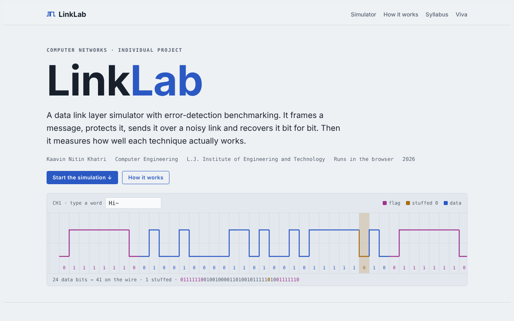
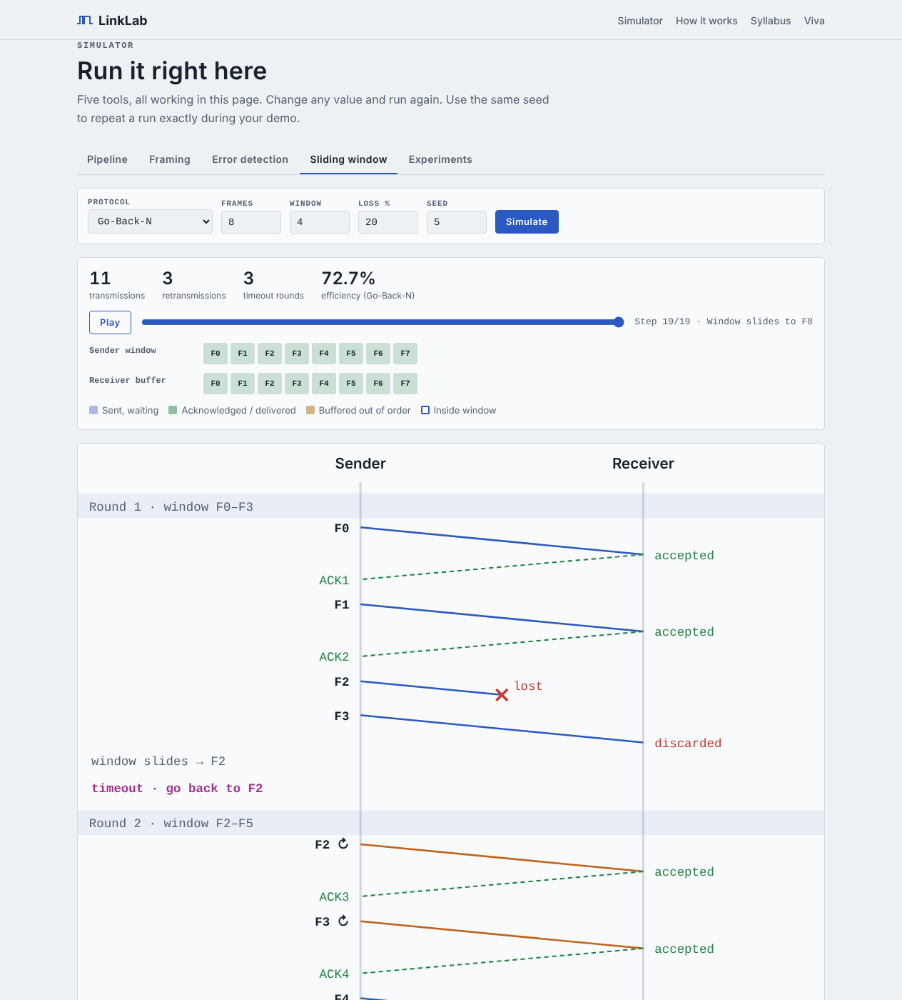
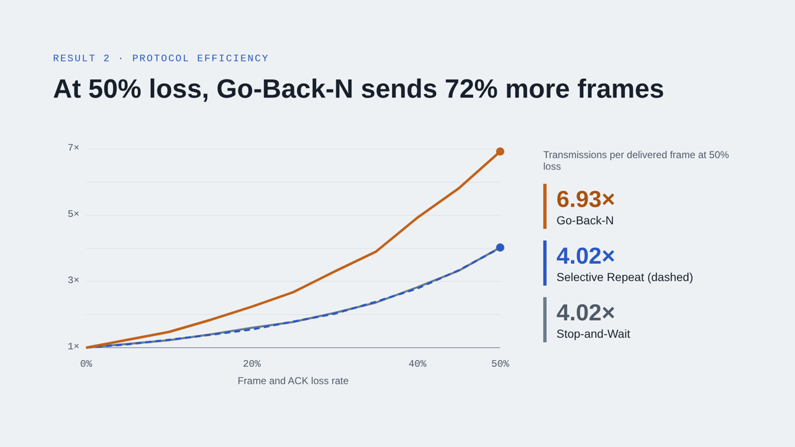

# LinkLab: Data Link Layer Simulator

LinkLab is a browser-based simulator that joins framing, error detection and flow control into one working frame pipeline, the way a real link uses them. A message is split into frames with a sequence number and CRC-8, bit-stuffed inside HDLC flags, sent over a simulated noisy channel, and checked and acknowledged by the receiver, which requests a resend for any corrupted frame. Built-in experiments run thousands of randomised trials. They show, for example, that CRC-8 catches every burst error of up to 8 bits while parity misses 39% of them, and that at 50% loss Go-Back-N needs 72% more transmissions than Selective Repeat. A companion Cisco Packet Tracer lab of two campuses joined by a serial WAN link shows the same ideas on real device models.

**Live demo:** https://kaavin-khatri.github.io/linklab-data-link-layer-simulator/

Computer Networks project · Kaavin Nitin Khatri · Computer Engineering, L.J. Institute of Engineering and Technology



## Features

| Tab | What it does |
| --- | --- |
| **Pipeline** | Type a message and transmit it. Each frame gets a sequence number and CRC-8, is bit-stuffed, may be hit by noise, and is ACKed or NAKed and resent until the message arrives intact. |
| **Framing** | Bit stuffing with the HDLC flag `01111110`, and byte stuffing with FLAG `~` (0x7E) and ESC `}` (0x7D). |
| **Error detection** | VRC (parity), LRC, CRC (CRC-4, CRC-8, CRC-16-CCITT) and a 16-bit checksum. Click any received bit to flip it and see the verdict; CRC shows the full long division. |
| **Sliding window** | Stop-and-Wait, Go-Back-N and Selective Repeat on an animated sender–receiver diagram, with frame and ACK loss and a repeatable seed. |
| **Experiments** | Detection rate of each method against six error patterns, and transmissions per frame for each protocol from 0% to 50% loss. |



## Results

| Error pattern | VRC | LRC | CRC-8 | Checksum-16 |
| --- | --- | --- | --- | --- |
| Single-bit | 100.00% | 100.00% | 100.00% | 100.00% |
| Two-bit | 94.80% | 89.55% | 99.80% | 97.40% |
| Three-bit | 100.00% | 100.00% | 100.00% | 99.80% |
| Burst ≤ 8 bits | 60.70% | 100.00% | 100.00% | 100.00% |
| Burst of 12 | 81.35% | 99.70% | 99.60% | 100.00% |
| Burst of 20 | 88.60% | 99.80% | 99.80% | 100.00% |

Share of corrupted frames detected, 2,000 random 16-byte frames per cell.



## Run it

- **In a browser:** open the live demo, or download `index.html` and double-click it. It works offline.
- **C version:** `gcc c-version/linklab.c -o linklab`, then run `./linklab` (or `linklab` on Windows).
- **Packet Tracer lab:** open `packet-tracer/LinkLab.pkt` in Cisco Packet Tracer 8.x or 9.x. The setup, configuration and demo steps are in `packet-tracer/LinkLab_PacketTracer_Guide.docx`.

## Repository contents

```
index.html                         Web simulator and project site (single file)
c-version/linklab.c                Same algorithms as a C console program
packet-tracer/LinkLab.pkt          Cisco Packet Tracer lab (2 routers, 2 switches, 4 PCs, 1 server)
packet-tracer/LinkLab_PacketTracer_Guide.docx
docs/LinkLab_Project_Report.pdf    Project report (also .docx)
docs/LinkLab_Presentation.pptx     14-slide presentation with speaker notes
docs/screenshots/                  Images used in this README
```

## Syllabus topics covered

Bit stuffing · byte stuffing · parity (odd/even) · VRC · LRC · CRC · checksum · flow control · Stop-and-Wait · Go-Back-N · Selective Repeat · HDLC and PPP framing · MAC addressing · OSPF (in the Packet Tracer lab)
